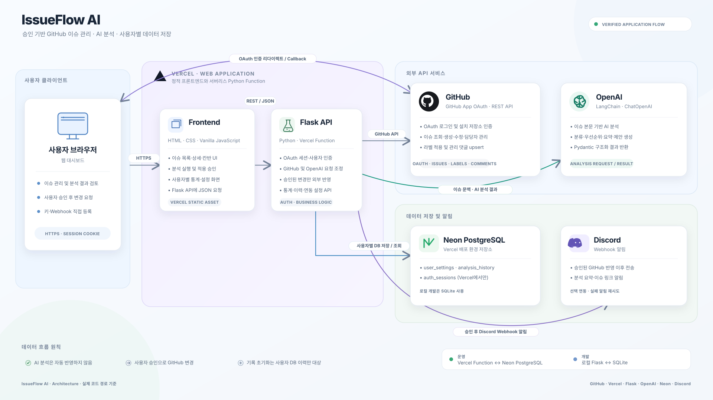

# IssueFlow AI

IssueFlow AI는 GitHub 이슈를 한곳에서 관리하고, 사용자가 직접 요청한 AI 분석을 검토한 뒤 선택적으로 GitHub에 반영하는 웹 대시보드입니다. 반복적인 이슈 분류와 우선순위 확인을 돕되, AI 분석만으로 GitHub 데이터를 변경하지 않도록 승인 흐름을 둡니다.

**서비스:** [https://issue-flow-ai.vercel.app](https://issue-flow-ai.vercel.app)  
**소스 코드:** [https://github.com/Kim-Ki-yeol/IssueFlow-AI](https://github.com/Kim-Ki-yeol/IssueFlow-AI)

## 시스템 아키텍처



다이어그램은 실제 웹앱의 브라우저·Vercel·Flask 연결과 GitHub, OpenAI, Neon PostgreSQL, Discord 간 데이터 흐름을 나타냅니다. 로컬 개발 시에는 Neon 대신 SQLite를 사용합니다.

## 주요 기능

- GitHub App OAuth 로그인과 사용자가 접근 가능한 설치 저장소 선택
- GitHub 이슈 조회, 생성·수정·닫기/재열기, 담당자·라벨·우선순위·댓글 관리
- 이슈를 직접 열고 요청하는 구조화된 AI 분석 및 재분석
- 분석 결과를 먼저 확인하고 사용자가 선택한 라벨 및 관리 댓글만 GitHub에 반영
- AI 작업 통계와 사용자별 분석 이력 조회 및 현재 사용자 이력 초기화
- OpenAI API 키와 선택적인 Discord Webhook 등록, 연결 테스트 및 해제
- 성공적으로 GitHub에 반영된 분석에 대해 선택적으로 Discord 알림 전송
- 검색·필터·정렬, 칸반 보드, 여러 이슈 일괄 관리

분석 기록 초기화는 현재 로그인 사용자의 DB 분석 이력만 지웁니다. 저장된 연동 설정, 로그인 정보, 다른 사용자 데이터, GitHub 이슈·라벨·댓글은 삭제하지 않습니다. GitHub에 이미 작성된 분석 댓글이나 라벨은 DB 이력 초기화의 영향을 받지 않습니다.

## 기술 스택

| 기술 | 역할 |
| --- | --- |
| Python, Flask | 웹 API, GitHub OAuth 콜백, 세션 인증, 서버 렌더링 템플릿 |
| HTML, CSS, Vanilla JavaScript | 반응형 대시보드와 API 연동 |
| GitHub App OAuth 및 GitHub REST API | 로그인, 설치 저장소 접근, 이슈·라벨·댓글 관리 |
| LangChain `ChatOpenAI`, Pydantic | OpenAI 모델 호출 및 구조화된 이슈 분석 결과 검증 |
| SQLite | 로컬 개발용 사용자 설정 및 분석 이력 저장 |
| Neon PostgreSQL, psycopg pool | Vercel 배포용 설정·이력·인증 세션 저장 |
| Discord Webhook | GitHub 반영 후 선택적 분석 알림 |
| Vercel | Flask Python Function과 정적 프론트엔드 자산 배포 |

## 사용자 이용 흐름

1. 사용자가 GitHub로 로그인하고 GitHub App이 설치된 저장소를 선택합니다.
2. 대시보드에서 OpenAI API 키와 필요한 경우 Discord Webhook을 등록합니다. 비밀 설정은 사용자별로 암호화 저장됩니다.
3. 사용자가 이슈를 열고 **AI 분석 실행**을 누릅니다. 이슈 제목·본문 등 분석 문맥이 서버에서 OpenAI로 전달됩니다.
4. 구조화된 분석 결과가 사용자별 분석 이력에 저장되어 대시보드에 표시됩니다. 이 단계에서는 GitHub를 변경하거나 Discord 알림을 보내지 않습니다.
5. 사용자가 적용할 라벨 및/또는 분석 댓글을 선택해 승인하면 GitHub에 반영됩니다. 기존 IssueFlow 관리 댓글이 있으면 찾아 갱신하여 재분석 댓글의 중복을 방지합니다.
6. GitHub 반영이 성공하면 설정된 Discord Webhook으로 알림을 보낼 수 있습니다. 분석 이력의 Discord 실패 건은 대시보드에서 재시도할 수 있습니다.

## GitHub OAuth 및 GitHub App

웹앱은 GitHub App OAuth Authorization Code 흐름을 사용합니다. 로그인 시작 시 CSRF 방지용 `state`를 만들고 Callback에서 비교한 다음, 인증 코드를 서버에서 토큰으로 교환합니다. 토큰은 브라우저에 전달하지 않고 서버 세션에 둡니다. 사용자는 접근 가능한 GitHub App 설치 저장소 중 하나를 선택하며, 서버는 해당 설치의 저장소 목록을 확인한 뒤 GitHub API를 호출합니다.

이슈 변경은 사용자가 대시보드에서 직접 요청한 작업만 수행합니다. AI 분석 자체는 읽기 및 이력 저장 단계이며, 라벨·댓글 반영은 별도 승인 후에 실행됩니다.

## OpenAI 분석 과정

사용자별로 저장한 OpenAI API 키를 서버에서 복호화하여 LangChain `ChatOpenAI`에 전달합니다. 현재 웹 대시보드는 `gpt-5.4-mini` 모델을 사용하며, 분류, 우선순위, 관련 영역, 요약, 추정 원인, 점검 제안 등을 Pydantic 스키마에 맞춰 생성합니다. 이슈 본문은 길이 제한을 적용하고, 코드·로그 발췌는 결과 검토를 돕는 참고 정보로 표시합니다. 분석 결과는 승인 전까지 GitHub에 쓰지 않습니다.

## 데이터 저장 및 사용자별 보안

- 로컬 실행은 `instance/issueflow.sqlite3`(또는 `ISSUEFLOW_DATABASE_PATH`) SQLite 파일을 사용합니다. 로컬 로그인 세션은 메모리에 유지됩니다.
- Vercel 환경(`VERCEL=1`)은 `DATABASE_URL`의 Neon PostgreSQL을 사용합니다. 연결은 프로세스별 제한된 psycopg 연결 풀을 이용합니다.
- `user_settings`: 사용자별 암호화 OpenAI 키, Discord Webhook, 선택 저장소
- `analysis_history`: 사용자 ID·저장소·이슈별 분석 결과와 GitHub/Discord 처리 상태
- `auth_sessions`(Vercel): 서버 측 GitHub 토큰(암호화), 사용자 정보, 만료 시각, 선택 저장소와 설치 ID
- 사용자 설정의 비밀값과 Vercel GitHub 토큰은 `DATA_ENCRYPTION_KEY`로 Fernet 암호화합니다. 브라우저 응답에는 비밀값 대신 등록 여부만 반환합니다.
- 사용자별 설정·이력 조회와 이력 초기화는 GitHub 사용자 ID로 범위를 제한합니다. DB 이력 초기화는 GitHub에 저장된 이슈·라벨·댓글을 삭제하지 않습니다.
- OAuth `state` 검증, 변경 요청의 cross-site 검사, HttpOnly·SameSite 쿠키(HTTPS 배포에서는 Secure)를 사용합니다.

`DATA_ENCRYPTION_KEY`는 Flask 세션 키와 별도로 안전하게 보관하고, 유실 시 암호화된 데이터를 복호화할 수 없으므로 백업해야 합니다. 비밀값을 소스 코드나 저장소에 기록하지 마세요.

## 로컬 실행 (Windows)

Python 3.12 이상을 권장합니다.

```powershell
python -m venv .venv
.\.venv\Scripts\Activate.ps1
python -m pip install -r requirements.txt
Copy-Item .env.example .env
```

`.env`에 아래 웹앱 설정을 구성합니다. 기존 `.env`가 있다면 덮어쓰지 말고 필요한 변수만 추가하세요.

| 변수 | 사용처 |
| --- | --- |
| `GITHUB_APP_CLIENT_ID`, `GITHUB_APP_CLIENT_SECRET` | GitHub App OAuth 로그인에 필요 |
| `FLASK_SECRET_KEY` | GitHub OAuth 구성과 Flask 세션 서명에 필요. 로컬에서도 고정값 사용 권장 |
| `DATA_ENCRYPTION_KEY` | 사용자 설정 암호화. Fernet 키를 생성하여 설정 |
| `GITHUB_OAUTH_REDIRECT_URI` | 선택 사항. 로컬에서는 현재 호스트로 자동 구성 |
| `COOKIE_SECURE` | 선택 사항. HTTPS 로컬 프록시 등에서 `true` 지정 |
| `ISSUEFLOW_DATABASE_PATH` | 선택 사항. SQLite 파일 경로 (기본값 `instance/issueflow.sqlite3`) |
| `PORT` | 선택 사항. 로컬 서버 포트 (기본값 `5000`) |

Fernet 키는 다음 명령으로 생성할 수 있습니다. 출력값을 비밀로 취급하세요.

```powershell
python -c "from cryptography.fernet import Fernet; print(Fernet.generate_key().decode())"
```

실행:

```powershell
python app.py
```

브라우저에서 `http://127.0.0.1:5000`을 열고 로그인합니다. 저장소 선택 후 대시보드에서 OpenAI 키와 필요한 경우 Discord Webhook을 등록합니다. 설정 화면은 키와 Webhook URL 자체를 다시 표시하지 않습니다.

### 수동 GitHub Actions 분석

저장소에는 `workflow_dispatch`로만 실행하는 별도 읽기 전용 분석 워크플로가 있습니다. 이 워크플로는 입력한 이슈를 분석하지만 웹앱 DB 이력에 저장하거나 GitHub 라벨·댓글·Discord를 변경하지 않습니다. 웹앱의 승인 기반 반영 기능과는 별도 경로입니다.

## 프로젝트 구조

```text
.
├── app.py                         Flask 앱, 인증 및 API 라우트
├── agent/
│   ├── analyzer.py                OpenAI 구조화 분석 및 댓글 미리보기
│   ├── config.py                  환경변수와 사용자별 서비스 설정
│   ├── github_auth.py             GitHub OAuth 및 App 설치 API
│   ├── github_client.py           GitHub 이슈·라벨·댓글 API
│   ├── notifier.py                Discord Webhook 알림
│   ├── service.py                 분석과 승인 후 GitHub 반영
│   ├── storage.py                 SQLite/PostgreSQL 저장소 및 세션
│   └── workflow.py                수동 실행용 읽기 전용 분석
├── templates/index.html           대시보드 HTML 템플릿
├── public/
│   ├── app.js                     대시보드 동작 및 API 요청
│   └── styles.css                 기존 반응형 UI 스타일
├── docs/architecture/             시스템 아키텍처 SVG/PNG
├── tests/                         외부 API 없는 Mock/단위 테스트
├── .github/workflows/             수동 GitHub Actions 워크플로
├── requirements.txt               Python 의존성
└── vercel.json                    정적 자산 및 Flask Function 라우팅
```

## 테스트

외부 GitHub, OpenAI, Discord API나 운영 Neon DB를 호출하지 않는 테스트:

```powershell
python -m unittest discover -s tests -v
```

프론트엔드 JavaScript 구문 검사는 Node.js가 설치된 경우 실행할 수 있습니다.

```powershell
node --check public/app.js
```

## Vercel 배포

`vercel.json`은 `app.py`를 `@vercel/python` Function으로 빌드하고 `public/**`를 정적 파일로 배포합니다. `/app.js`, `/styles.css`는 정적 자산으로 재작성하며 나머지 요청은 Flask Function으로 전달합니다. 프로젝트 Root Directory는 `app.py`와 `vercel.json`이 있는 저장소 루트로 설정합니다.

Vercel 프로젝트 환경변수:

| 변수 | 설명 |
| --- | --- |
| `DATABASE_URL` | Neon PostgreSQL 연결 문자열 |
| `GITHUB_APP_CLIENT_ID`, `GITHUB_APP_CLIENT_SECRET` | GitHub App OAuth 자격 증명 |
| `GITHUB_OAUTH_REDIRECT_URI` | `https://issue-flow-ai.vercel.app/auth/github/callback` 등 실제 배포 도메인의 HTTPS Callback |
| `FLASK_SECRET_KEY` | 재배포 후에도 유지되는 Flask 세션 서명 키 |
| `DATA_ENCRYPTION_KEY` | 사용자 설정과 서버 세션 토큰 암호화 키 |

Vercel이 `VERCEL=1`을 제공하며 이때 앱은 PostgreSQL을 사용하고 Secure 세션 쿠키를 설정합니다. 배포 후 GitHub App의 OAuth Callback URL이 배포 URL과 일치하는지 확인하세요. Neon 연결 및 Vercel 운영 배포는 로컬 Mock 테스트로 검증되지 않습니다.
